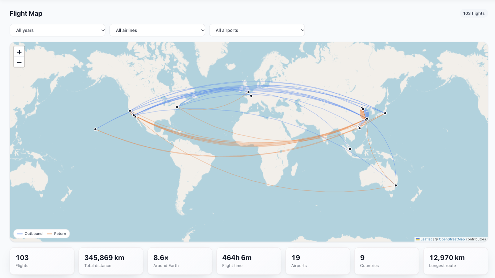
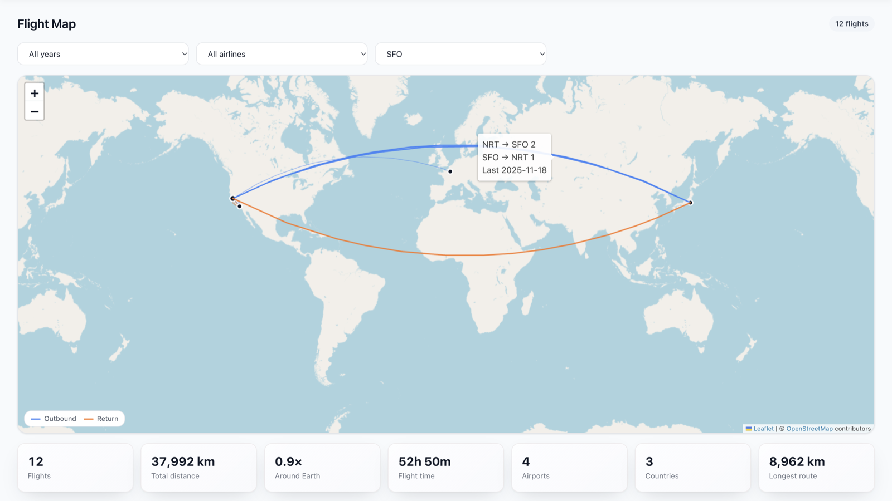
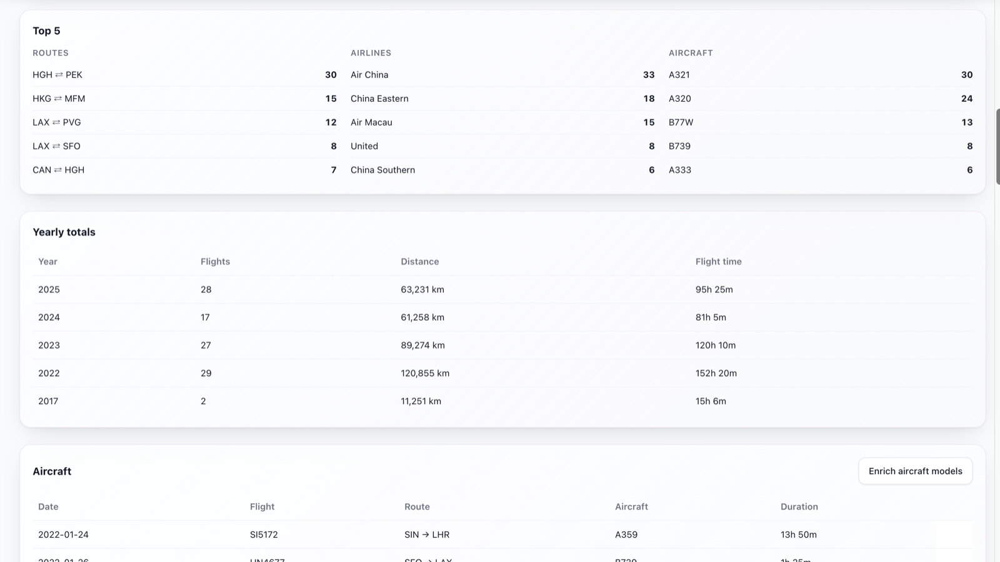
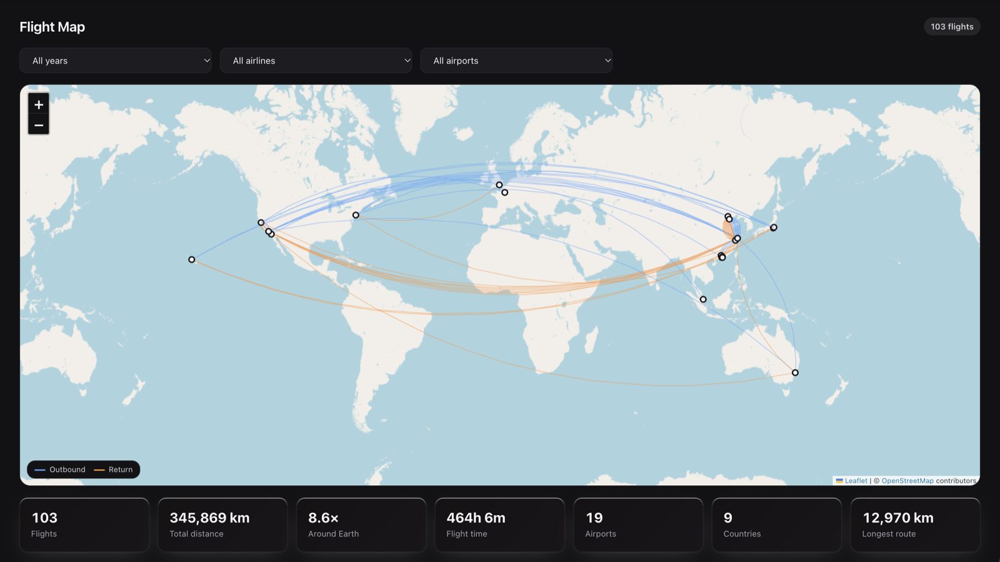

# Flight Map

A personal world map of every flight you have taken, with distance, flight time and
airport statistics, built from the flight reservations already in your TREK trips.

## What it does

Flight Map adds a **Flight Map** page to TREK. It reads the flight reservations in every
trip you own or are a member of and draws each leg as an arc on a world map: outbound
legs in blue, return legs in orange, with parallel arcs when you flew the same route more
than once. Hover a route to see its direction, count and last date; click an airport to
filter the map and statistics to it.

Below the map you get your totals (flights, distance, times around the Earth, flight
time, airports, countries and longest route), a Top 5 of routes, airlines and aircraft,
and a year-by-year breakdown. Filter everything by year, airline or airport.

- **Multi-leg bookings** are split into their legs, and each leg's time is worked out
  from local departure and arrival times in their own time zones. When a booking has no
  times, the flight time is estimated from the distance.
- **Past flights from before you used TREK** can be pasted in, one per line:
  `2019-05-01, PEK, SFO, CA985, Air China, B77W`. Only the date and the two IATA
  airport codes are required. Lines that already exist are skipped, and the same flight
  in two trips (or in a trip and in your pasted list) is counted once.
- **Aircraft models** can be filled in for flights that have a flight number but no
  aircraft, using an optional AirLabs key. Every answer is stored, so each flight number
  costs at most one AirLabs request.
- Works in TREK's light and dark themes. Map tiles come from OpenStreetMap and are
  fetched by the plugin server, so the page runs inside TREK's plugin sandbox.

Flight Map only reads your trips. It never changes a reservation.

## Screenshots

Click an airport to filter the map and statistics to it; hover a route for its direction,
count and last date.

Top 5 routes, airlines and aircraft, and yearly totals.

In TREK's dark theme.

## Permissions

| Permission | Why |
|---|---|
| `db:own` | Stores the past flights you paste in and the aircraft models looked up from AirLabs. |
| `db:read:trips` | Reads the flight reservations of the trips you can access, to draw them on the map. |
| `http:outbound` | Lets the plugin server make outbound requests, limited to the two hosts below. |
| `http:outbound:tile.openstreetmap.org` | Fetches the OpenStreetMap tiles the map is drawn on. |
| `http:outbound:airlabs.co` | Looks up aircraft models, only when you click **Enrich aircraft models** and an admin has set an AirLabs key. |

## Setup

1. **Admin → Plugins**: install Flight Map, approve its permissions and activate it.
   Requires TREK 4.x (see [Compatibility](#compatibility)).
2. Open **Flight Map** from the TREK navigation. Your flight reservations appear straight
   away; there is nothing to configure.
3. Optional: to fill in aircraft models, create a free key at
   [airlabs.co](https://airlabs.co) and enter it as **AirLabs API key** in the plugin's
   settings. The key is shared by everyone on the instance. AirLabs mostly knows current
   and recent flights, so older flights may stay without an aircraft.

Map data © [OpenStreetMap](https://www.openstreetmap.org/copyright) contributors.

## Compatibility

- Requires **TREK >=4.0.0 <5.0.0**. TREK will not install or activate the plugin outside
  that range.
- No external account is needed. AirLabs is optional and only used for aircraft models.

## Support

- Issues and questions: https://github.com/Thewhitelight/trek-plugin-flight-map/issues

## License

MIT, see [LICENSE](./LICENSE).

---

This is a community plugin. It is not maintained or endorsed by the TREK core team.
Install third-party plugins at your own risk after reviewing their declared permissions.
